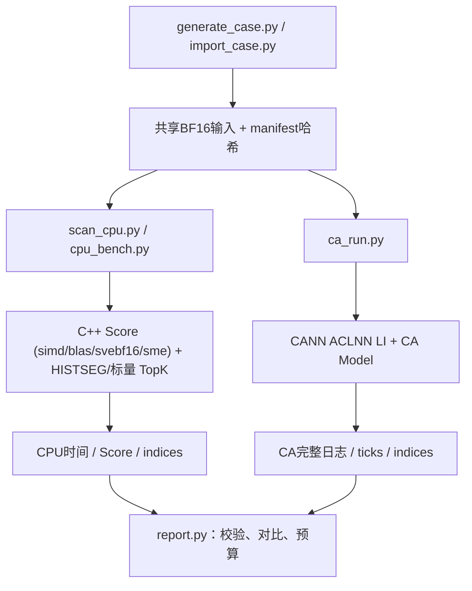

# LI 算子 CPU 卸载评估项目

版本：2.2，2026-11-19；CPU原生ABI=3。

> 本次修订：新增 SME 打分版本。BF16 加速后端可在编译阶段选择 SVE2 `svbfdot_f32` 或 SME `svmopa_za32_f32_m`；运行时新增 `--score-backend sme`，默认构建仍为 SVE2，`svebf16` 行为不变。上一版：按仓库当前代码和 `results/` 中实际存在的测量数据校正文档。

## 1. 项目目标和交付范围

目标是评估：历史cache未来放到CPU以节省NPU内存时，将LI（Lightning Indexer）的 **Score计算与TopK选择** 放到CPU是否有价值，需要多少CPU物理核，性能相对于A5 CA模型预测有什么变化。

项目实现一个完整闭环：

1. 生成DeepSeek-V3.2代表形状、BF16精度的共享负载。
2. CPU和CA从同一份不可变输入读取数据，SHA256验证一致性。
3. CPU执行C++并行LI，测原生时延、Python封装时延、阶段时间和核心数扩展性。
4. CA执行现有CANN LI融合算子，保存完整日志和输出，提取模型tick。
5. 分开验证打分、TopK与跨设备输出，并生成JSON/CSV/Markdown对比报告。
6. 计算模型下可用的“传输+同步时间预算”，辅助后续卸载链路设计。

**这是CPU实测与A5 CA性能模型的比较，不是A5上板实测，也不是完整模型端到端加速测试。**Q/W投影、RoPE、真实CPU/NPU传输、增量cache更新、选中KV搬运和下游Attention尚未实现。

当前只实现本任务主路径：Q/K/W同为BF16、Query=BSND、Key=PA_BSND、N2=1、D=128、sparse_mode=0/3、仅返回索引。主生成器使用mode=3、return_values=False。没有把官方FP8/scale路径混入BF16结论。

CPU 打分的可执行后端有四个：`simd`（NEON FMLA，**`cpu_bench.py`/`cpu_api.py` 的默认值**）、`blas`（需 `--blas` 编译，单线程 cblas_sgemm）、`svebf16`（SVE2 `svbfdot_f32`，16 MAC/指令，目标机主用，**必须显式指定**）和 `sme`（SME `svmopa_za32_f32_m` 外积累加，需 `--sme` 编译，**必须显式指定**）。SVE 与 SME 是**编译期二选一**的同一个 BF16 加速后端（native backend id=2）：默认 `scripts/build_cpu.sh` 编入 SVE2，`scripts/build_cpu.sh --sme` 编入 SME；运行时 `svebf16` 与 `sme` 都指向该后端，实际实现由构建决定，`result.json` 的 `score_impl` 字段给出 `sve2` 或 `sme`。所有既有 `results/` 性能数据都来自 SVE2 的 `svebf16`，SME 数据需重新测量。

## 2. 架构与公共输入



标准case目录：

| 文件 | 格式/作用 |
|---|---|
| manifest.json | schema、case_id、生成来源、元数据和全部输入SHA256 |
| li_a2_meta.json | 原C++ runner可读的shape/layout/K/mask等平坦JSON |
| li_query.bf16 | Q，uint16 BF16位模式、小端，shape=[B,S1,H,D] |
| li_key.bf16 | PA物理Key，shape=[blocks,block_size,1,D] |
| li_weights.bf16 | W，shape=[B,S1,H] |
| li_a2_query.f32 / key.f32 / weights.f32 | 上述BF16提升到FP32后的精确数值，兼容现有CA加载器 |
| li_a2_aq.i32 | B个有效Query长度 |
| li_a2_ak.i32 | B个有效Key长度 |
| li_a2_bt.i32 | PA块表，[B,max_blocks]，无效尾块填-1 |

CPU原生接口直接读取BF16位模式，不依赖PyTorch。CA runner从.f32重新转换BF16；因为.f32已经是BF16值的精确提升，有限值可以逐位还原。CA运行后再次核对输入哈希，避免静默改变精度或布局。

case_id由元数据和所有输入文件哈希产生，CPU/CA结果必须一致；只用同一个随机种子或相同shape不作为输入一致性证明。case文件与结果分目录保存，新目录默认不覆盖已有文件。

## 3. DeepSeek-V3.2负载

模型固定参数：Indexer Query heads=64、head_dim=128、TopK=2048；共享一个Indexer Key head。来源：

- https://huggingface.co/deepseek-ai/DeepSeek-V3.2/blob/main/config.json
- https://huggingface.co/deepseek-ai/DeepSeek-V3.2/blob/main/inference/model.py

官方参考Indexer使用FP8/scale。本项目采用BF16输入、FP32计算，报告名称应为 **DeepSeek-V3.2代表形状的BF16 LI**。随机输入仅是形状微基准，不能当成模型真实激活分布；import_case允许使用已有实际输入。

### 预设

| preset | B | S1 | T | H | TopK | 目的 |
|---|---:|---:|---:|---:|---:|---|
| smoke | 2 | 3 | 257 | 8 | 32 | 首次流程和正确性，非DeepSeek主负载 |
| decode_16k | 1 | 1 | 16384 | 64 | 2048 | 单请求Decode |
| decode_32k | 1 | 1 | 32768 | 64 | 2048 | 同上 |
| decode_64k | 1 | 1 | 65536 | 64 | 2048 | 推荐主测试 |
| decode_128k | 1 | 1 | 131072 | 64 | 2048 | 长上下文 |
| batch8_64k | 8 | 1 | 65536 | 64 | 2048 | 批量Decode |
| batch32_64k | 32 | 1 | 65536 | 64 | 2048 | 更高并发 |
| prefill128_16k | 1 | 128 | 16384 | 64 | 2048 | 分块Prefill补充测试 |
| regression_a2 | 18 | 3 | 约3K | 16 | 2048 | 原负载回归；有效Key为[3016]×17+[3072]、469物理块 |

B、S1和T是本项目实验选点，不声称线上部署固定使用这些值。block_size默认128；除回归用例外自动分配足够的物理块，并随机排列块表。

T是当前总有效Key数，包括已经放入cache的当前位置；不是物理预分配容量或TopK。mode=3时第b个请求、第i个有效Query的可见长度：

```text
v(b,i) = max(0, ak[b] - aq[b] + i + 1)
有效输出数 = min(K,v)
```

padding Query输出全-1。TopK行数为sum(aq)*N2，64个head先合并为一行Score，不是64行TopK。

### 单请求存储与计算规模

| T | BF16逻辑Key | FP32 Score | 仅QK点积工作量 |
|---:|---:|---:|---:|
| 16K | 4 MiB | 64 KiB | 约0.268 GFLOPs |
| 32K | 8 MiB | 128 KiB | 约0.537 GFLOPs |
| 64K | 16 MiB | 256 KiB | 约1.074 GFLOPs |
| 128K | 32 MiB | 512 KiB | 约2.147 GFLOPs |

表中B=S1=1，按一次乘加2 FLOPs估算；不含转换、加权、TopK。FP32 Score不保留head维，避免全量[B,H,S1,T]中间矩阵。

## 4. 文件逐项说明

| 文件 | 输入 | 输出/功能 |
|---|---|---|
| VERSION.txt | 无 | 项目/ABI/目标环境版本 |
| requirements.txt | pip | 仅NumPy依赖，主测试无PyTorch依赖 |
| generate_case.py | preset、shape覆盖、seed、分布、PA block_size、out | 创建共享case及manifest |
| import_case.py | 已有li_a2_*目录、out | 导入历史CA负载，不改源目录 |
| caseio.py | case目录 | 验证哈希、加载BF16/长度/块表、BF16转换、逻辑Key读取 |
| cpu_api.py | Case与并行参数 | ctypes工作区接口CPUOp，复用输出和原生缓冲 |
| cpu_bench.py | case、线程/tile/后端/采样参数 | CPU result.json、indices.i32、可选scores.f32；--score-backend 支持 simd/blas/svebf16/sme |
| topology.py | NUMA节点、Linux sysfs、允许CPU集合 | 实际物理核/SMT sibling分组 |
| scan_cpu.py | case、物理核数列表、NUMA节点、SMT、CPU参数 | 每点独立进程、绑定CPU/内存、summary.csv/scan.json |
| ca_run.py | case、runner、环境片段、模型配置、日志范围证据 | CA日志、输入快照、indices.i32、result.json |
| verify.py | case、indices、可选Score | 离线结构检查和FP32 golden诊断 |
| validation.py | Case、indices、Score | 独立NumPy参考和选择正确性函数 |
| report.py | case、CPU scan.json、CA result.json | comparison.md/.csv/.json、传输预算敏感性 |
| environment.py | out | CPU/NUMA/编译器/CANN路径等复现元数据，不采集密码 |
| config/timing_evidence.example.json | 模板，默认未确认 | 描述CA tick统计范围与时钟域，不自动假定有效 |
| native/cpu_li.cpp | BF16数组、PA表、长度、工作区参数 | 原生并行Score+TopK，ABI=3；Score 含 SVE2 BF16(`svbfdot_f32`) / SME(`svmopa_za32_f32_m`，编译期选择) / simd / blas 后端 |
| native/histogram.hpp | sortable uint32键、字节、私有缓冲 | HISTSEG/标量256-bin统计 |
| native/li_aclnn_bench.cpp | 原li_a2_meta和.f32/.i32输入 | 现有ACLNN两段式LI调用、完整输出、结构检查 |
| scripts/build_cpu.sh | --scalar/--sme/--blas、编译环境变量 | build/libli_cpu.so；默认 -march=armv9-a+sve2+bf16（SVE2 打分），--sme 改为 -march=armv9-a+sve2+bf16+sme 并定义 LI_SCORE_USE_SME |
| scripts/build_ca.sh | 用户确认的CANN路径 | build/li_aclnn_bench |
| CPU_LI_Algorithm_and_Parallel_Design.md | — | CPU 路径算法/精度/并行实现详解 |
| run_cases.sh | 已生成的 cases/ | 8 个 preset × 核数 × SMT 全量扫描，并汇总 results/_chart_summary.csv |
| ca_env.sh | CANN 安装路径 | CA 运行所需 LD_LIBRARY_PATH/PYTHONPATH 环境片段（只 export，不启动程序） |

仓库不含独立单元测试目录；正确性由 `cpu_bench.py --verify golden`、`verify.py` 和每点 `result.json` 中的 `validation` 字段给出。

## 5. CPU侧算法与优化

对每个可见Key：

```text
score[b,i,j] = sum_h W[b,i,h] * ReLU(sum_d Q[b,i,h,d] * K[b,j,d])
```

### Score阶段

任务维度为(batch,query_tile,key_tile)，一个任务完成所负责Key区间的全部head，写入不重叠Score区域。没有head维跨线程归约，也不会对每个head复制整个Key。

四个可选后端（`--score-backend simd|blas|svebf16|sme`）：

1. simd（默认）：一次读取/转换局部Key，复用于多个Query；同时计算4个head的点积，通过OpenMP SIMD提示向量化D维（NEON FMLA，每指令约4 MAC）。
2. blas：将一个Key tile转换成FP32，调用单线程cblas_sgemm，矩阵形状为[query_tile*H,D]乘[Key_tile,D]转置，再ReLU、权重归约。局部中间量只覆盖一个tile。需 `build_cpu.sh --blas`。
3. svebf16（目标机主用，需显式指定）：SVE2 BF16 点积 `svbfdot_f32`，VL=256 时每次调用 16 MAC（8 个 fp32 lane × 2 项点积，bf16 输入、fp32 累加）。Q/K 保持 BF16 位模式，按“lane=head、元素对=维”交错成 qbf/kdup 布局（kdup 把 key 的相邻两维广播到各 head lane）。实际分派：
   - `score_bf16_4row_hg2`：H==16，一次算 4 个 key。
   - `score_bf16_4row_hg4`：H%32==0，一次算 4 个 key、4 个 head 组（H=64 时循环 2 次）。
   - `score_bf16_compact`：其余 H（如 24），单 key。
   - `score_bf16_2row_hg8` 与 `score_bf16_row` 已实现但当前没有调用点。

  SVE2 构建下若 H%8!=0、D%2!=0 或调用线程 `li_vl()!=256`，请求的 svebf16 会降级为 simd；标量构建请求 svebf16 直接报错 -8，不降级。
4. sme（编译期替代 SVE2，需 `build_cpu.sh --sme`）：用 SME 外积累加指令 `svmopa_za32_f32_m` 计算 QKᵀ。一个 query 的 Q 先转置并提升为 FP32（`D×H`），8 个 key 的一段也提升为 FP32（`D×8`）；对每个维度 d 执行 `ZA[h][j] += Q[h][d] * K[j][d]`，在 VL=256 的 ZA32 tile（8 head × 8 key）上一次完成 64 个点积，再按 `relu(dot)*W` 沿 head 归约。FP32 累加与 golden 参考一致；H 需为 `svcntw()`（VL=256 时为 8）的倍数，否则自动回退到 SVE2 或 simd。SME 需要支持 SME 的编译器与 `-march=... +sme`（例如 GCC 14+/Clang 16+），且目标 CPU 实际支持 SME；在 SVE2-only 机器上请勿使用该构建。

   SVE 与 SME 不能在同一 .so 中运行时切换：`svebf16` 与 `sme` 两个运行时名字都选择 native backend id=2，真实实现由构建宏 `LI_SCORE_USE_SME` 决定；SVE 构建下请求 `sme` 会在加载库时直接报错 -9，SME 构建下 `svebf16` 也会执行 SME 内核。`CPUOp.info()`/`result.json` 的 `score_impl`、`sme_compiled` 可用于确认实际构建。

四者都有外层OpenMP任务并行。BLAS必须使用单线程后端，防止P个外层线程各自再启动P个内部线程。扫描器设OPENBLAS/MKL/BLIS线程为1及OMP_MAX_ACTIVE_LEVELS=1；`CPUOp` 能识别 `openblas_set_num_threads`/`MKL_Set_Num_Threads`/`mkl_set_num_threads` 时还会调用它将线程设为1，`result.json` 的 `blas_thread_setter_used` 记录是否识别到。其他BLAS实现需要按厂商要求配置单线程。

`simd`、`blas`、以及当前编入的 BF16 加速后端（SVE2 或 SME）可以在同一个 .so 上运行时切换；但 SVE2 与 SME 之间必须重新编译，不能通过 `--score-backend` 在同一 .so 内切换。

### kdup L1 融合

Score 主路径采用 **kdup L1 融合**：按 4-key 组（8KB）构建一次 key 复制布局后立即执行点积，替代“整 tile（256KB）预构建再读回”的旧方案，使 key 尽量常驻 L1、减少对 L2 的回读。旧方案与本方案的对比数据不在仓库内，需自行用同一 case 重测。

### 多核与参数调优

- 目标机为 2 socket × 4 NUMA 共 **192 物理核**（Kunpeng 950 @ 2.3GHz，governor=performance），每核 2 个 SMT sibling，node 内物理核数 48。用 `scan_cpu.py --node 0,1,2,3 --cores 192`，绑定物理核与节点内存，并设 `--wait-policy ACTIVE`。
- 参数逐 case 调优：key_tile、query_tile、TopK groups。规律：Score 占主体的重负载尽量用满核；TopK 锁步轮次使 barrier 开销随线程数上升，因此行数少 / 每行 Key 小（如 decode 系列、regression_a2）常需较少核数或较小组数。
- CA 参考取 `ca_run.py` 写出的 `candidate_duration_us`。未提供确认过的 `--timing-evidence` 时 `timing_scope_confirmed=false`，`li_latency_kind` 为 `single_li_model_lifecycle_proxy`，只能作量级参考；见第 15 节。

### TopK阶段

FP32分数转sortable uint32，依次处理byte3、byte2、byte1、byte0。每轮统计256-bin、找到第K大所在bin、调整剩余排名、压缩该bin候选，四轮得到阈值。

- 行数充足：各线程独立处理不同Query行，使用私有直方图。
- 行数不足：划分多个协作组，每组负责一行，各线程统计自己的候选，再归并256bin。
- 自动组数G=min(有效Query行数,线程数)；没有行时保留空组。
- 组内先收集GT，再按全局逻辑索引顺序用EQ补足K。无需共享原子直方图。
- 正负零归一为同分；非有限Score报错。
- sorted模式最终按分数降序、同分索引升序排序；unordered省去最终排序，仍使用确定的边界同分选择。

HISTSEG按128bit段计数字节；256bit VL包含两个段，先扩宽u32再相加累积。线程私有字节缓冲/候选区复用，不逐轮malloc。逐线程校验VL，标量构建请求HISTSEG会报错，不静默降级。

优化点还包括：一个OpenMP团队贯穿转换、打分和TopK；工作区跨调用复用；按PA物理块局部读取而非每次整段gather/转换；不沿用NPU固定8192 trunk限制；K>=有效长度时跳过radix选择。

仍存在的限制：协作组之间用全团队屏障推进radix，长度不均衡时会等待；单行最终排序串行；Prefill不是完整优化GEMM融合内核；TopK 在行数少 / 每行 Key 小时并行度受行数上限，barrier 开销随线程数上升（多核扫描已支持 `--node 0,1,2,3` 与 192 核）。

## 6. NPU/CA侧算法和调用流程

NPU侧执行已安装CANN中的lightning_indexer融合kernel，使用用户提供的接口：

```text
aclnnLightningIndexerGetWorkspaceSize → 获取本次executor
aclnnLightningIndexer → 同步完成
```

每次执行都新建第一段结果，避免重复使用同一executor。输入输出和足够大的Device workspace复用。runner默认warmup=0、iters=1，减少CA总tick范围歧义；直接调用runner可改次数，但多次调用的进程级tick不能自动认定为单次LI时间。

源码路径参考：https://gitcode.com/cann/ops-transformer/tree/master/attention/lightning_indexer 。链接master不等于本机libopapi实际加载kernel的提交版本。请在日志/证据中记录实际版本、kernel名、tiling key及block dim；报告保留相关日志行和runner哈希。

runner默认仅输出索引，检查数量、范围、重复和padding，不把SANITY当成TopK数值正确性证明。输出排序/同分最终验收以实际目标版本kernel及测试比较规则为准。CPU侧 `cpu_bench.py`/`scan_cpu.py` 默认 `--order unordered`（原生 `CPUOp` 默认 `sorted`，直接调用时请显式指定），可用 `--order sorted` 取完整排序参考；范围证据未明确排序契约时，报告会保留“ordering unresolved”，不会把额外排序成本隐藏掉。

## 7. 计时口径：两端如何对齐

### 主对照

| 项目 | CPU | A5 CA |
|---|---|---|
| 输入位置 | 已在CPU内存 | 已在模型GM/Device输入位置 |
| 工作区 | 提前分配，reuse为主 | Device workspace已准备 |
| 主时间 | C++执行内prepare+Score+TopK，含必要转换、线程团队开销 | 确认 evidence 后为一次完整LI关键路径；当前仓库只有生命周期代理值 |
| 主时间不含 | 磁盘读写、SHA、输入生成、Python/ctypes开销、工作区构造 | 宿主仿真耗时、输入文件读写、Host tiling/launch等未建模成本 |
| 补充时间 | Python调用及per-call分配模式 | runner Host墙钟，仅作仿真成本诊断 |

CPU侧结果中的时间字段：

| 字段 | 计时范围 | 用途 |
|---|---|---|
| **native** | C++ 原生 LI 的总执行时间 | **CPU/NPU 算法性能对比的主指标** |
| **host** | Python 发起调用到调用返回的时间，包括 ctypes、原生执行及少量封装操作 | 观察 Python 接口调用开销 |
| **prepare** | 本次执行的任务构造、进入 OpenMP 并行区、Q/W 转 FP32、Score 和索引缓冲区初始化 | 观察执行准备开销 |
| **score** | PA 寻址、Key 读取和转换、QK 点积、ReLU、W 加权及跨 head 求和 | 观察得分计算开销 |
| **topk** | 浮点得分转整数排序键、直方图统计、阈值查找、候选筛选及索引写入 | 观察 TopK 开销；`unordered` 时不含最终 `std::sort` |
| **total** | 与 **native** 使用同一个原生总时间样本 | 在分阶段结果中展示完整 LI 时间 |

CPU结果同时记录native和host时间；CA不能拿RESULT avg_ms与CPU比，它是宿主仿真开销。CPU native也不是“仅算术指令时间”，线程启动/同步和必要转换确实属于CPU执行成本。

NPU主指标为`model_li_latency_us`, CA tick只有在统计范围和时钟域确认后才换算为model_li_latency_us：

```text
duration_us = ticks / frequency_MHz
821888 / 1650 = 498.1139393939 us   # 本机一次 decode_64k CA 运行的 Total tick 换算示例
```

cube_freq=1650给出配置频率，但不单独证明Total tick的时钟域、是否整算子、是否单次或多核汇总。程序无法从这个字段名字反推出定义。

默认ca_run会记录候选时间和原始tick行，timing_scope_confirmed=false。确认后提供证据JSON，不需改程序：

```json
{
  "confirmed": true,
  "scope": "single_complete_li_critical_path",
  "frequency_mhz": 1650.0,
  "clock_domain": "填写已确认的Total tick计数时钟域",
  "evidence": "填写仿真器说明或流水证据，说明该记录覆盖完整LI关键路径",
  "source_revision": "实际内核/源码版本",
  "output_order": "sorted"
}
```

output_order可填sorted或unordered，应根据目标源码/测试，而不是猜测。项目不会自动把示例模板标为已确认。多条tick不自动相加；选择--tick-index之前必须识别core/task/kernel归属。一次aclnn内部若有多个kernel，仍需确认选中的记录覆盖完整LI。

报告中的model_compute_comparison_ready还检查：CA成功退出、结构检查、CPU独立golden、跨设备数值诊断、排序契约、输入ID。未满足时仍生成暂定数据和原因，不伪造结论。

### 缓存和分配对照

- input-copies=1：同一缓冲反复执行，可能热驻留。
- input-copies>1：相同逻辑数据的多个物理副本轮换，不自动保证冷内存；报告总输入footprint。
- allocation=reuse：主对照；allocation=per-call：补充Python端创建/释放工作区成本。
- CA首次调用的初始cache状态与CPU预热后的状态不一定相同，需要记录模型cache设置，分开解释冷热条件。
- CPU性能测量与CA仿真不要同时在同一服务器竞争资源。

## 8. 安装与构建

需要：Linux、Python3.9+、NumPy、g++支持C++17/OpenMP；正式CPU为ARM SVE2，VL=256；扫描依赖numactl。CA侧使用现有CANN 9.2.0、Ascend950PR_9589模型及已验证的环境设置。

```bash
cd li_offload_eval
python3 -m pip install -r requirements.txt
bash scripts/build_cpu.sh
source /home/Ascend/cann-9.2.0/set_env.sh
bash scripts/build_ca.sh
python3 environment.py --out results/environment.json
```

不要为本项目替换已匹配的CANN/PyTorch安装。主CPU实现不需要PyTorch。

### CPU构建参数

```bash
bash scripts/build_cpu.sh                  # ARM SVE2（-march=armv9-a+sve2+bf16），默认编入 HISTSEG 与 SVE2 svbfdot_f32 打分
bash scripts/build_cpu.sh --sme            # 编译期改为 SME 打分（-march=armv9-a+sve2+bf16+sme，-DLI_SCORE_USE_SME）
bash scripts/build_cpu.sh --blas           # 额外编入 CBLAS 后端，需 BLAS_CFLAGS/BLAS_LIBS
bash scripts/build_cpu.sh --sme --blas     # SME 打分 + BLAS 后端
bash scripts/build_cpu.sh --scalar         # 非SVE构建，运行时须加 --hist scalar 且不能用 svebf16/sme
```

SVE 与 SME 是编译期选择，不能在同一构建内并存。切换后需重新编译，并让 `--library`/`build/libli_cpu.so` 指向新库；SME 构建在运行时使用 `--score-backend sme`（也可用兼容名 `svebf16`，实际执行 SME）。
```

目标 ARM 机推荐运行配置（svebf16 后端、多 NUMA 绑核、ACTIVE 等待策略）：

```bash
python3 scan_cpu.py --case cases/decode_64k --out results/cpu_decode_64k_192 \
  --node 0,1,2,3 --cores 192 --tile 128 --query-tile 1 --hist histseg \
  --score-backend svebf16 --wait-policy ACTIVE --warmup 5 --iters 60 --verify golden
```

`scan_cpu.py` 自己设置 `OMP_PLACES`/`OMP_PROC_BIND`/`OMP_WAIT_POLICY` 并用 numactl 绑核绑内存，不要在外面重复设置或把父进程 taskset 到窄核集。

环境变量：CXX指定编译器；BLAS_LIBS默认-lopenblas；BLAS_CFLAGS指定厂商头文件位置。例如：

```bash
BLAS_CFLAGS='-I/opt/OpenBLAS/include' \
BLAS_LIBS='-L/opt/OpenBLAS/lib -lopenblas' \
bash scripts/build_cpu.sh --blas
```

库路径应使用服务器实际BLAS安装。若动态加载需要，按现有环境配置LD_LIBRARY_PATH。没有BLAS依赖也能使用 simd/svebf16 打分后端。

可以保留当前库，再编译带BLAS的版本：
```bash
cp build/libli_cpu.so build/libli_cpu_before_blas.so

BLAS_CFLAGS="$(pkg-config --cflags openblas)" \
BLAS_LIBS="$(pkg-config --libs openblas)" \
bash scripts/build_cpu.sh --blas

ldd build/libli_cpu.so
```

### CA构建与环境

`scripts/build_ca.sh` 以 `${LI_CANN_ROOT:-/home/Ascend/cann-9.2.0}` 为根，链接 `aarch64-linux/lib64` 及 `plugin/opskernel`、`plugin/nnengine`（存在时），额外的链接目录可用 `LI_CANN_LINK_DIRS` 追加；不嵌入 RPATH，运行时库选择由 CA 环境脚本决定：

```bash
g++ -O2 -std=c++17 -Wall -Wextra native/li_aclnn_bench.cpp -o build/li_aclnn_bench \
  -I${CANN_ROOT}/include -L${LIB_DIR} -Wl,-rpath-link,${LIB_DIR} \
  -lopapi -lnnopbase -lascendcl -lruntime -lpthread
```

`ca_env.sh` 是只做 `export` 的环境片段（LD_LIBRARY_PATH/PYTHONPATH/PATH/ASCEND_*），末行不启动任何程序；`ca_run.py --env-script` 会拒绝内含旧runner启动命令的片段。

本机模型配置目录：

```text
/home/Ascend/cann-9.2.0/aarch64-linux/simulator/Ascend950PR_9589/lib/config.json
/home/Ascend/cann-9.2.0/aarch64-linux/simulator/Ascend950PR_9589/lib/config_stars.json
```

## 9. 从零完成一个case

### 第一步：小负载验证

```bash
python3 generate_case.py --preset smoke --out cases/smoke
python3 cpu_bench.py --case cases/smoke --threads 4 \
  --warmup 2 --iters 10 --verify golden --save-scores --out results/smoke_cpu
```

这是功能检查，尚未显式绑定每个线程。正式性能用扫描器。标量构建加--hist scalar。

### 第二步：CPU核心扫描

单 NUMA，无 SMT 与开 SMT 各一套（`--out` 必须不存在或为空目录，已有结果请换名）：

```bash
python3 generate_case.py --preset decode_64k --out cases/decode_64k
python3 scan_cpu.py --case cases/decode_64k --out results/cpu_decode_64k \
  --node 0 --cores 1,2,4,8,16,24,32,48 \
  --core-policy balanced --memory-policy auto --wait-policy ACTIVE \
  --tile 128 --query-tile 1 --hist histseg \
  --score-backend svebf16 --warmup 5 --iters 60 --verify golden
python3 scan_cpu.py --case cases/decode_64k --out results/cpu_decode_64k_smt \
  --node 0 --cores 1,2,4,8,16,24,32,48 --smt \
  --core-policy balanced --memory-policy auto --wait-policy ACTIVE \
  --tile 128 --query-tile 1 --hist histseg \
  --score-backend svebf16 --warmup 5 --iters 60 --verify golden
```

多 NUMA（`--cores` 是跨节点合计的物理核数，不是每节点核数）：

```bash
python3 scan_cpu.py --case cases/decode_64k \
  --node 0,1 --cores 64,96 \
  --core-policy compact --memory-policy auto --wait-policy ACTIVE \
  --tile 128 --query-tile 1 --hist histseg --score-backend svebf16 \
  --warmup 10 --iters 100 --verify golden --save-scores \
  --out results/cpu_decode_64k_numa01 --smt
```

每个 NUMA node 48 物理核 / 96 逻辑 CPU；不加 `--smt` 时每物理核选一个 CPU（node 0 默认 0,2,…94），以 `thread_siblings_list` 为准。`scan_cpu.py` 显式设置 `OMP_PLACES`/`OMP_PROC_BIND` 固定线程，numactl 在分配输入前绑定同节点内存。默认 `--wait-policy PASSIVE`，`ACTIVE` 用于整组对照。

加上 `--smt` 后，使用选中物理核的两个硬件线程。

不要给 scan_cpu 额外传 `--threads`；线程数由物理核数与 SMT 决定。不要先把父进程 taskset 到单核再运行 scanner。

`--tile 128`：Score 计算时每个 Key 分块最多 128 个 token，不修改 PA block_size。

`--query-tile 1`：一个 Score 任务最多处理一个 Query；decode 用例 S1=1，因此就是一个。

全量扫描（8 个 preset × 1/16/48/96/192 核 × 有/无 SMT）用 `bash run_cases.sh`，结束后生成 `results/_chart_summary.csv`。

### 第三步：CA执行相同case

```bash
python3 ca_run.py --case cases/decode_64k \
  --exe build/li_aclnn_bench --env-script ca_env.sh \
  --freq-mhz 1650 --timeout 3600 \
  --out results/ca_decode_64k
```

model-config参数用于归档实际配置，不会替你选择模型或修改仿真核数；模型选择仍由现有环境决定。ini路径使用你已确认的真实路径。案例复制到结果目录inputs/后运行，canonical case不被原地覆盖。

程序等完整子进程结束后才收集结果，不在第一次Total tick/DONE出现时提前宣布完成。超时会终止自己创建的进程组，避免遗留CA任务与后续CPU测试竞争。返回码、日志、输出和哈希均保存。

CA耗时长，先对smoke执行这条流程。主wrapper固定warmup=0/iters=1；CPU的100次采样不能照搬给CA。

确认CA计数定义后，给同一条命令加--timing-evidence config/your_verified_timing.json。如果仿真已经完成，可避免重跑，导入完整日志与输出：

```bash
python3 ca_run.py --case cases/decode_64k \
  --import-log results/ca_decode_64k/ca.log \
  --import-indices results/ca_decode_64k/indices.i32 \
  --timing-evidence config/your_verified_timing.json \
  --out results/ca_decode_64k_imported
```

导入模式不会重新观察原进程退出码，报告因此保留该限制。优先使用最初就带证据配置的新运行结果。导入日志若没有completed_li_calls=1标记，不能仅凭一条tick强行确认单次范围。

### 第四步：独立验证CA结果

```bash
python3 verify.py --case cases/decode_64k \
  --indices results/ca_decode_64k/indices.i32 --golden \
  --out results/ca_decode_64k/validation.json
```

该诊断与仓库验收规则区分；默认atol=1e-3、rtol=1e-4，可据目标版本要求调整。排序/同分导致的精确集合差异与阈值违规分别记录。

### 第五步：生成报告

```bash
python3 report.py --case cases/decode_64k \
  --cpu-scan results/cpu_decode_64k/scan.json \
  --ca-result results/ca_decode_64k/result.json \
  --transport-us 0,5,10,20 --out results/comparison_decode_64k
```

得到comparison.md、comparison.csv、comparison.json。CA范围未确认也会输出暂定比值并说明原因。不要将未确认的数据改标题为“真实A5性能”。

## 10. 修改负载、核心数和实现参数

### 修改shape与上下文

```bash
python3 generate_case.py --preset decode_64k --context 32768 \
  --batch 8 --queries 1 --heads 64 --topk 2048 --out cases/custom_b8_32k
```

生成器参数：--preset、--out、--batch、--queries、--context、--heads、--topk、--seed、--block-size、--distribution normal/legacy_uniform。D固定128，N2固定1，逻辑精度固定BF16。`--heads` 只接受 8/16/24/32/64；`--topk` 限 1..2048，或 3072..8192 且为1024倍数。

normal使用标准正态Q/K/W；legacy_uniform使用Q/K在[-1,1)、W在[-130,130)的分布，便于对照原生成方式。NumPy与PyTorch随机序列不保证相同，所以两端必须读取同一份文件。regression_a2调整B/T后可能需要改预设的物理块容量；新模型矩阵优先用decode/batch预设。

### 扫描主负载

```bash
for preset in decode_16k decode_32k decode_64k decode_128k; do
  python3 generate_case.py --preset "$preset" --out "cases/$preset"
  python3 scan_cpu.py --case "cases/$preset" --node 0 \
    --cores 1,2,4,8,16,24,32,48 --tile 128 --score-backend svebf16 --save-scores \
    --out "results/cpu_$preset"
done
```

正式目标机推荐 192 核 / 4 NUMA + ACTIVE 的整机扫描（见第 8 节），并与 CA 参考对比优劣配置。

各节示例按需执行：已经生成的case直接复用，不重复生成；已有结果目录请另取新名称。每组CA单独运行一次，长上下文不要并发提交多个CA任务到同一宿主机。

### SMT对照

```bash
python3 scan_cpu.py --case cases/decode_64k --node 0 \
  --cores 1,2,4,8,16,24,32,48 --smt --score-backend svebf16 --save-scores \
  --out results/cpu_decode_64k_smt
```

最后一点是48物理核96线程。比较相同物理核数量下的SMT收益，不把96线程当96物理核。16K/tile128有128个Score任务，能够覆盖96线程；tile256只有64任务，可能限制SMT结果。

### 分块/后端对照

```bash
python3 scan_cpu.py --case cases/decode_64k --cores 1,8,16,32,48 \
  --score-backend blas --tile 256 --save-scores --out results/cpu_blas_t256
python3 scan_cpu.py --case cases/decode_64k --cores 1,8,16,32,48 \
  --score-backend simd --save-scores --out results/cpu_simd
python3 scan_cpu.py --case cases/decode_64k --cores 1,8,16,32,48 \
  --score-backend svebf16 --save-scores --out results/cpu_svebf16
# 需先执行 bash scripts/build_cpu.sh --sme 并把 build/libli_cpu.so 指到该构建
python3 scan_cpu.py --case cases/decode_64k --cores 1,8,16,32,48 \
  --score-backend sme --save-scores --out results/cpu_sme
python3 scan_cpu.py --case cases/decode_64k --cores 1,8,16,32,48 \
  --hist scalar --save-scores --out results/cpu_scalar_hist
python3 scan_cpu.py --case cases/decode_64k --cores 1,8,16,32,48 \
  --score-backend svebf16 --order unordered --save-scores --out results/cpu_unordered
```

blas要求编入BLAS后端；sme要求用 `--sme` 构建且目标 CPU 支持 SME，SVE2 与 SME 结果必须来自两个不同的 `.so`，不可在同一 `.so` 上切换；hist scalar在同一SVE2构建中也可使用，只改变直方图路径。unordered是否可用于最终严格对比取决于目标输出契约；保留sorted作为完整排序参考。

### 多Query复用与内存条件

```bash
python3 generate_case.py --preset prefill128_16k --out cases/prefill128
python3 scan_cpu.py --case cases/prefill128 --cores 1,8,16,32,48 \
  --score-backend svebf16 --query-tile 4 --save-scores --out results/prefill_qtile4
python3 scan_cpu.py --case cases/decode_64k --cores 1,8,16,32,48 \
  --score-backend svebf16 --input-copies 16 --warmup 32 --iters 200 --save-scores --out results/rotating16
python3 scan_cpu.py --case cases/decode_64k --cores 1,8,16,32,48 \
  --score-backend svebf16 --allocation per-call --save-scores --out results/per_call
```

qtile改变实现粒度，queries改变负载。固定tile/qtile的一条曲线用于强扩展；逐核数挑最佳参数的结果另报告为调优曲线。B32/64K仅逻辑Key已约512MiB，16副本约8GiB，另加工作区/Score，先估算内存。

## 11. CLI 参数速查

### cpu_bench.py

| 参数 | 默认 | 作用 |
|---|---|---|
| --case / --out | 必填 | 输入case目录、独立输出目录 |
| --threads | 1 | 原生线程数，单独使用不自动绑定物理核 |
| --tile / --query-tile | 128 / 1 | Score任务Key/Query粒度 |
| --groups | 0 | TopK组数，0自动，或1..threads |
| --hist | histseg | histseg/scalar |
| --order | unordered | sorted/unordered；sorted 额外做最终稳定排序 |
| --score-backend | simd | simd/blas/svebf16/sme；目标机对照用 svebf16 或 sme（由构建决定实际实现） |
| --allocation | reuse | reuse/per-call |
| --warmup / --iters | 10 / 100 | CPU预热和正式采样次数；还有一次不计时预检查 |
| --input-copies | 1 | 轮换相同逻辑输入的物理副本数 |
| --verify | golden | none/selection/golden；正式结果建议golden |
| --atol / --rtol | 1e-3 / 1e-4 | FP32打分参考容差 |
| --require-pinning | 关闭 | 校验工作线程位置数量和绑定环境；scanner自动打开 |
| --save-scores | 关闭 | 保存FP32 Score供跨设备阈值诊断，生成报告建议打开 |
| --library | build/libli_cpu.so | 指定原生库，主要用于诊断 |

### scan_cpu.py

| 参数 | 默认 | 作用 |
|---|---|---|
| --case / --out | 必填 | case及扫描结果根目录；--out 须新目录或空目录 |
| --node | 0 | 一个 LI 进程使用的NUMA节点，可用 `0,1` |
| --cores | 1,2,4,8,16,24,32,48 | **跨所有--node合计**的物理核数列表，唯一、不超过可用核数 |
| --smt | 关闭 | 每物理核使用两个在线SMT sibling（要求每核恰好2个） |
| --core-policy | balanced | balanced 轮流从各节点取核；compact 先用完第一个节点 |
| --memory-policy | auto | auto：单节点绑定，多节点交错；也可强制 bind/interleave |
| --wait-policy | PASSIVE | PASSIVE/ACTIVE，整组统一写入 OMP_WAIT_POLICY |
| --topk-policy | auto | auto 保留原生组数选择；independent 每点令 groups=线程数 |
| --groups | 无 | 仅在 auto 策略下手动指定原生 TopK 组数，0 表示原生自动 |
| --order | unordered | 显式转发给 cpu_bench.py |
| --dry-run | 关闭 | 只打印选核与将执行的命令 |
| 其他CPU参数 | 转交 | 如 --tile、--hist、--score-backend、--iters；--threads/--require-pinning 由scanner控制并拒绝外部传入 |

`--topk-policy independent` 与 `--groups` 互斥。independent 模式下scanner会校验结果中的实际组数等于线程数。CSV 与 `scan.json` 记录策略、请求组数、实际组数、CPU 列表与实际参与节点。

### ca_run.py

| 参数 | 默认 | 作用 |
|---|---|---|
| --case / --out | 必填 | case与独立CA结果目录 |
| --exe | build/li_aclnn_bench | 原生runner |
| --env-script | 无 | 仅环境设置shell片段；不传时继承当前环境 |
| --model-config | 无 | 归档实际ini，不自动激活或修改它 |
| --freq-mhz | 1650 | 候选tick换算频率，不代表自动证明时钟域 |
| --timing-evidence | 无 | 已核实范围/时钟/排序契约的JSON |
| --tick-index | 无 | 0起始选择已识别的tick记录；多条时不自动选 |
| --timeout | 1800秒 | 自己启动的CA子进程超时后终止进程组 |
| --import-log / --import-indices | 无 | 导入历史完整日志和输出，避免重复仿真 |

### verify.py / report.py / environment.py

- verify：--case、--indices、--out必填；--scores可选原生Score，--golden启用独立参考，--atol/--rtol指定诊断容差。
- report：--case、--cpu-scan、--ca-result、--out必填；--transport-us默认0,5,10,20微秒是假设扫描，--atol/--rtol控制跨设备阈值诊断。
- environment：--out指定元数据JSON。
- import_case：--dir旧目录、--out新目录；默认要求.f32本来可精确表示为BF16，--allow-bf16-rounding才允许新增舍入。

## 12. 输出与指标解释

CPU每点：result.json、indices.i32、可选scores.f32。扫描根目录：scan.json、summary.csv。

| 指标 | 含义 |
|---|---|
| native_median_us / native_p90_us | C++原生主测量（entry-to-completion），包含必要转换和线程团队 |
| host_median_us / host_p90_us | Python/ctypes完整调用，per-call还包含构造/释放 |
| stage_median_us.prepare | 任务准备、Q/W转换、初始化 |
| stage_median_us.score | PA读取、Key转换、QK/ReLU/加权 |
| stage_median_us.topk | sortable key、四轮选择、收集、可选排序 |
| actual_threads / worker_cpus / worker_vl_bits / topk_groups | 实际团队、CPU位置、各线程VL、实际TopK组数 |
| input_pool_bytes / resident_input_bytes_per_copy | 所有输入副本占用、单副本占用（均不含原生工作区） |
| validation | 结构检查、原生Score上的精确TopK、独立NumPy打分结果 |
| output_sha256 | 输出索引/Score哈希，报告生成前复核未被覆盖 |
| samples_native_us / samples_host_us | 逐次样本，便于复核异常值 |
| cache_condition | input-copies=1 记 `repeated_single_buffer`，否则 `rotating_buffers_residency_not_guaranteed` |
| sve2_compiled / sme_compiled / score_impl / blas_compiled / blas_thread_setter_used | 构建与后端配置事实；score_impl 为 sve2 或 sme |
| main_thread_affinity / omp_environment | 主线程允许CPU集合与 OMP_*/BLAS 线程环境 |
| platform / numpy / native_library_sha256 | 复现元数据 |
| query_tokens_per_second | `sum(aq) / native_median`，单层LI的Query吞吐 |

阶段中位数不保证相加等于总中位数。当前输出P90，不将100个样本声称为稳定P99。query_tokens_per_second是单层LI处理的Query数，不是完整模型生成token/s。

扩展性：第一点P0核为基线时，speedup=T(P0)/T(P)，efficiency=speedup/(P/P0)。列表第一点设1才是通常的单核加速比。SMT分别在相同物理核数下比较。

对比报告：

- CPU/CA<1表示CPU耗时小于对应CA模型参考；未确认范围时只是暂定比值。
- communication_budget_us = CA参考 - CPU原生。为正表示模型下可留给传输/同步的预算；不是部署收益证明。
- transport_sensitivity为“假设总传输同步开销”的扫描，不能当成PCIe/互联实测。
- logical/physical_indexer_key_bytes仅描述Indexer Key，不代表主Attention全部KV cache的节省量。
- 还需考虑CPU核资源成本、CA模型误差、缓存条件、主机运行时和下游Attention。

## 13. 正确性分层

1. 输入：case_id、逐文件SHA256、shape/dtype/长度/PA块表。
2. CPU打分：独立NumPy FP32矩阵乘与head求和，检查数值容差；不是调用原生实现生成自己的golden。
3. CPU TopK：在原生Score上用完整稳定排序对照，检查集合及排序，避免浮点误差干扰选择算法验证。
4. CA输出：索引范围、重复、应有有效数和padding；再用FP32参考或已验证CPU Score进行阈值诊断。
5. 跨设备：精确集合一致与同分/误差容差分开记录。最终严格验收以实际目标commit仓库比较规则为准。

sorted CPU要求同分索引升序；CA比较默认不擅自要求这一平局规则。不能仅以两端集合有差异就认定内核错误，也不能把“范围合法”当成TopK正确。

## 14. 复用原有CA负载

```bash
python3 import_case.py --dir /home/p00951281/topk/a2 --out cases/a2_imported
python3 scan_cpu.py --case cases/a2_imported --cores 1,8,16,32,48 \
  --score-backend svebf16 --save-scores --out results/a2_imported_cpu
```

这会保留原.f32的BF16数值和PA映射，导入新case目录；不会修改原a2。若已有CA输出和日志可按第9节导入，但旧runner曾复用executor且warmup=1时，不应将旧tick自动升级为确认的单次LI性能。建议用修订runner先跑小负载，再重测关键case。

## 15. 验证状态与实测数据

仓库不含 `tests/` 目录，也没有独立单元测试脚本。可复现的正确性证据来自以下三处：

1. `cpu_bench.py --verify golden`：用 `validation.py` 的独立 NumPy FP32 参考比较 Score（`atol=1e-3, rtol=1e-4`），并在原生 Score 上做完整稳定排序对照，结果写入 `result.json` 的 `validation`。
2. `verify.py`：对任意 indices 做结构检查（数量/范围/重复/padding），`--golden` 时用 FP32 参考做阈值诊断。
3. 每次测量都记录 `native_library_sha256`、`case_id`、`worker_vl_bits`、实际线程与 CPU 位置，报告阶段重新校验输出哈希与 `case_id`。

本仓库 `results/` 中已有的测量（Kunpeng 950，governor=performance，SVE2 `svebf16`，tile=128，histseg，order=unordered，1 个 NUMA 节点）；下述表格均来自 SVE2 构建，不包含 SME 数据：

decode_64k 单 NUMA 扫描（`results/cpu_decode_64k`，无 SMT）：

| 物理核 | 线程 | native µs | speedup | score µs | topk µs | prepare µs |
|---:|---:|---:|---:|---:|---:|---:|
| 1 | 1 | 22128.0 | 1.00 | 21591.3 | 526.5 | 6.1 |
| 2 | 2 | 11142.0 | 1.99 | 10864.3 | 274.4 | 4.0 |
| 4 | 4 | 5571.4 | 3.97 | 5429.6 | 135.9 | 3.5 |
| 8 | 8 | 2946.8 | 7.51 | 2867.9 | 70.7 | 3.7 |
| 16 | 16 | 1487.2 | 14.88 | 1432.9 | 45.7 | 5.8 |
| 24 | 24 | 1037.4 | 21.33 | 986.2 | 40.5 | 7.9 |
| 32 | 32 | 776.3 | 28.50 | 719.9 | 42.2 | 9.9 |
| 48 | 48 | 567.1 | 39.02 | 497.2 | 49.6 | 13.4 |

decode_64k 单 NUMA 扫描（`results/cpu_decode_64k_smt`，`--smt`，线程数=2×物理核）：

| 物理核 | 线程 | native µs | speedup | score µs | topk µs | prepare µs |
|---:|---:|---:|---:|---:|---:|---:|
| 1 | 2 | 21155.7 | 1.00 | 20641.7 | 504.1 | 7.5 |
| 2 | 4 | 10610.5 | 1.99 | 10369.2 | 234.3 | 5.3 |
| 4 | 8 | 5316.6 | 3.98 | 5189.1 | 120.7 | 4.7 |
| 8 | 16 | 2704.6 | 7.82 | 2630.2 | 66.9 | 5.1 |
| 16 | 32 | 1392.9 | 15.19 | 1327.3 | 50.8 | 8.6 |
| 24 | 48 | 988.5 | 21.40 | 921.1 | 49.6 | 11.3 |
| 32 | 64 | 752.0 | 28.13 | 675.9 | 53.9 | 14.5 |
| 48 | 96 | 630.4 | 33.56 | 529.6 | 68.7 | 20.1 |

所有点的 `validation.status` 均为 PASS（mode=golden），`worker_vl_bits` 全为 256。

仓库内这两份 `scan.json` 的 `rows[].result` 已改为指向 `results/cpu_decode_64k*/cores_*/result.json`，可直接用于 `report.py`。把扫描目录整体搬移后需要重新生成或修正这些路径，否则 `report.py` 会报文件不存在。

### 与 A5 CA 的对比口径

未提供确认过的 `--timing-evidence` 时，`ca_run.py` 的 `li_latency_kind` 是 `single_li_model_lifecycle_proxy`、`timing_scope_confirmed=false`；此时 `candidate_duration_us` 是“一次单调用模型生命周期的 Total tick 换算值”，含模型自身启动/收尾开销。因此：

- 只能作为量级参考，不能称为 A5 实测或已确认的关键路径时延。
- `report.py` 会把每个点标为“暂定”并列出原因（`CA tick scope not confirmed`、`output ordering contract unresolved/mismatched`），`model_compute_comparison_ready` 为 false。
- 一旦按第 7 节提供确认过的 timing evidence，报告才升级为 `confirmed_li_critical_path`。

跨 preset 的完整对比需要自行跑 `bash run_cases.sh` 与 `ca_run.py`；本仓库不附带未经验证的性能结论。

## 16. 典型故障

| 现象 | 处理 |
|---|---|
| ABI不匹配/找不到libli_cpu.so | 编译当前项目，不混用旧v2库 |
| scalar构建请求HISTSEG | 加--hist scalar或重新SVE2编译 |
| 请求svebf16报错 -8 | 用SVE2构建（`-march=armv9-a+sve2+bf16`），并确认 H%8==0、D%2==0 |
| 请求sme报错 -9 | 当前库未编入SME；执行 `bash scripts/build_cpu.sh --sme` 后重试 |
| SME构建编译失败 | 编译器需支持SME ACLE（GCC 14+/Clang 16+）且 `-march` 含 `+sme`；目标机需实际支持SME |
| H不是8的倍数，svebf16/sme实际跑的是simd | 该情况静默降级；改用 H=8/16/32/64 或接受降级 |
| 某工作线程VL非256 | 看worker_vl_bits，检查线程VL设置 |
| 48核不可用 | 看cpuset/父进程affinity/offline CPU；scanner不越过已有资源限制 |
| BLAS找不到cblas.h/库 | 配置实际厂商BLAS头/库；也可先用 simd 后端 |
| 线程数膨胀/BLAS曲线异常 | 确保BLAS单线程，检查OPENBLAS/MKL/BLIS环境与库实现 |
| CA无Total tick/多条tick | 保留全日志、识别范围；无明确整算子时间不自动相加 |
| 读取旧CA结果不“ready” | 旧退出码/调用范围未观察到，报告保留暂定限制 |
| CPU/CA case_id不同 | 使用同一case文件；修改shape后新生成case并重跑两端 |
| CA验证失败或超时 | 查看ca.log和returncode，先解决调用/正确性，不形成性能结论 |
| 正负零/同分集合不同 | 按目标规则检查；精确集合差异与阈值误差分开分析 |
| 修改--context仍旧负载 | 负载在generate_case阶段决定，bench只读取case，换新case路径 |

首轮可复现检查：`generate_case.py --preset smoke` → `cpu_bench.py --verify golden` → `scan_cpu.py --dry-run`，再跑目标 case 的完整扫描与 CA。

## 17. 技术依据

- DeepSeek-V3.2官方配置/Indexer，见第3节链接。
- 用户原始radix_topk_sve2.cpp、lightning_indexer_cpu.py、benchmark.py的加权ReLU打分和radix选择逻辑；本项目改进数据布局、并行、缓冲复用和测量。
- 用户原始li_aclnn_bench.cpp与确认的CANN 9.2.0/950PR库路径，修复executor复用和验证口径。
- Arm HISTSEG语义：https://learn.arm.com/insights/sve/ 。
- CANN两段式接口规范：https://gitee.com/ascend/cann-ops-adv/blob/v0.7-8.0.0.alpha002/docs/common/%E4%B8%A4%E6%AE%B5%E5%BC%8F%E6%8E%A5%E5%8F%A3.md?skip_mobile=true 。

## 18. Python原生接口与底层runner参数

```python
from caseio import Case
from cpu_api import CPUOp

case = Case('cases/decode_64k')  # 包括哈希检查，不放在计时循环内
with CPUOp(case, threads=8, key_tile=128, query_tile=1,
           hist='histseg', order='sorted', groups=0,
           score_backend='svebf16') as op:  # SME 构建可改为 'sme'
    indices, score, timing_ms = op.run()
    saved_indices = indices.copy()
    print(op.info())
```

CPUOp的输入是Case或case目录，其他参数与cpu_bench的threads/tile/query-tile/hist/order/groups/backend对应；library可指定ABI=3共享库。run返回indices `[B,S1,1,K]` int32、score `[B,S1,max(ak)]` FP32及四个阶段时间ms。下次run会覆盖缓冲，长期保存需copy。上下文管理器或close释放工作区；同一工作区并发run/info/close会报错，避免越界释放与输出竞争。

Native错误码：-1参数/长度/块表错误，-2工作线程VL不为256，-4标量构建请求HISTSEG，-5实际团队数不符合请求，-6非有限Score，-7未编译BLAS，-8加速BF16后端不可用（标量构建或 H%8/D%2/VL=256 不满足）；-9由 `cpu_api.py` 在运行时请求 `sme` 但当前库未编入SME时抛出。工作区创建失败以空指针通知Python转MemoryError。

底层CA runner支持以下参数，但正式ca_run协议固定一次调用：

| runner参数 | 默认 | 说明 |
|---|---|---|
| --dir | . | 原li_a2_*输入目录 |
| --iters | 1 | 正式调用数，每次都重新GetWorkspaceSize |
| --warmup | 0 | 预热同样执行CA任务，多次时需分别确认tick范围 |
| --validate-only | 关闭 | 检查输入，不初始化ACL或执行kernel；启动仍需能加载链接库 |
| --allow-bf16-rounding | 关闭 | 仅诊断允许额外舍入；标准case不应需要此选项 |
| --help | — | 参数帮助 |

runner导出li_out.i32，并输出SANITY/STRUCTURAL。valid总数只在每行候选>=K且没有padding Query时等于B*S1*N2*K，通常应逐行求和min(K,v)。PASS_STRUCTURAL_ONLY不是golden通过，Total tick由外部模型产生。

可选BLAS生产构建建议使用厂商单线程版本。OMP_MAX_ACTIVE_LEVELS对不同OpenMP运行时之间的嵌套并不构成普遍保证；未识别常见线程设置函数的BLAS需要按厂商要求限制线程，不能把未经确认的多层线程结果当成物理核线性度。
